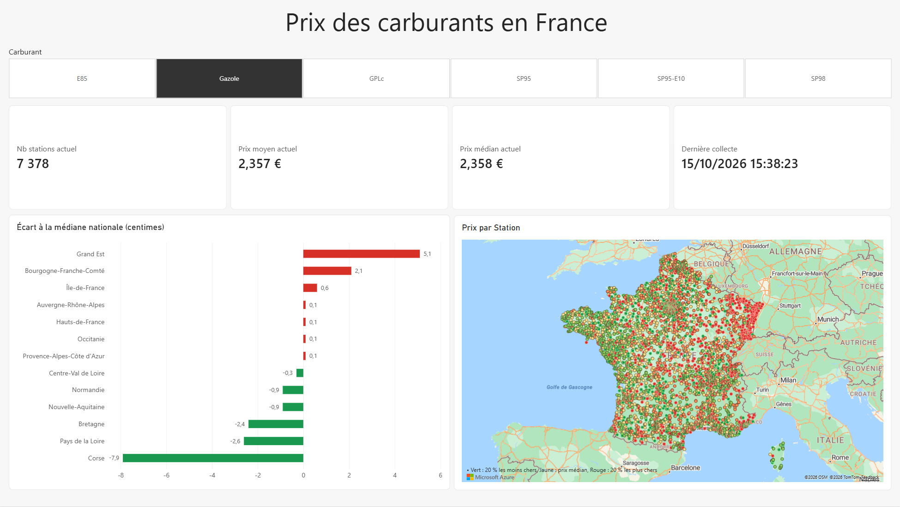
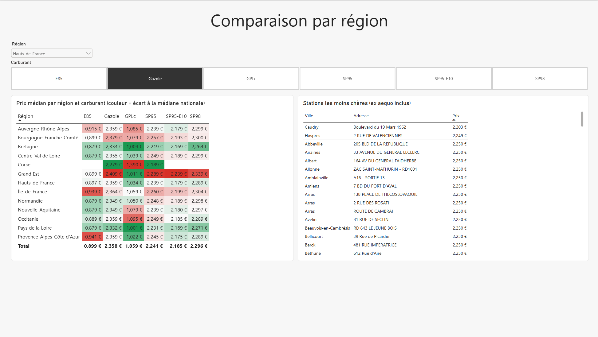
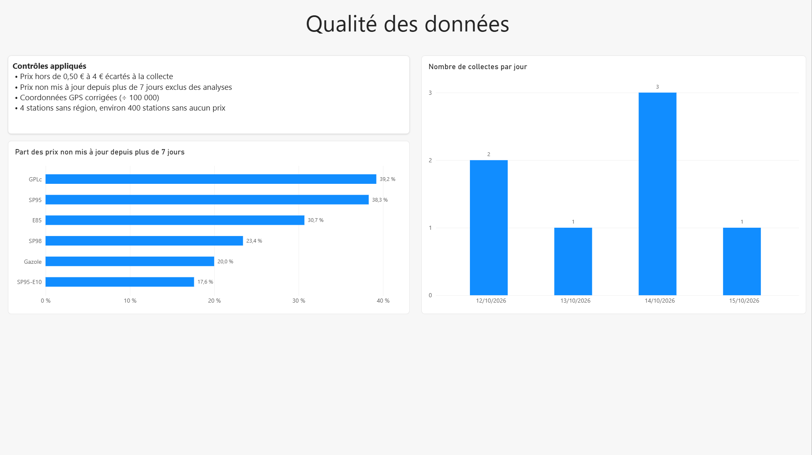

# French Fuel Prices: From Open Data API to Power BI

[](https://github.com/Furkan-Mtl/fuel-prices-france/actions/workflows/tests.yml)

> Personal project built with **Python, FastAPI, PostgreSQL, SQL, dbt, Power BI, Git and GitHub Actions**

An end-to-end data pipeline that collects the prices of every fuel station in France every day, stores them in PostgreSQL, transforms and tests them with dbt, turns them into a three-page Power BI dashboard and exposes them through a REST API.



## Business questions

1. How much does each fuel cost today in France, and how do regions compare with the national median?
2. Where are the cheapest stations in a given region?
3. How reliable is the data: how many prices are out of date, and does the collection run every day?

## Architecture

```
Open data API (data.economie.gouv.fr)
        │  daily at 09:00 (Windows Task Scheduler)
        ▼
collecte.py : reshape to long format + quality checks ──► data/raw/*.csv
        │
        ▼
chargement.py : idempotent load (ON CONFLICT) ──► PostgreSQL
                                                   ├─ stations
                                                   ├─ prix (history)
                                                   └─ v_prix_actuels (view)
        │
        ├──► dbt : staging views, tested marts ──► schemas staging / marts
        ├──► Power BI (star schema, DAX measures, 3 report pages)
        └──► api.py : REST API (FastAPI) on current prices
```

## What I built

**Collection (Python, Requests, Pandas)**
- The API only returns *current* prices so the script runs every day to build a price history.
- The data is reshaped into a long format: one row per station and per fuel (9,800 stations and 31,000 prices per collection).
- Quality checks run before saving: non-numeric prices, prices outside 0.50–4 € and duplicates are counted, then removed.

**Storage (PostgreSQL)**
- Two tables, `stations` and `prix`, with a composite primary key `(id_station, carburant, date_collecte)`.
- The load is idempotent: running the pipeline twice never creates duplicates (`ON CONFLICT DO NOTHING` / `DO UPDATE`).
- The view `v_prix_actuels` keeps the latest collection only and excludes prices not updated for more than 7 days.
- Credentials live in a `.env` file that is never committed.

**SQL analysis** (`sql/03_analyses.sql`)
- Mean vs median per fuel, gazole price by region, cheapest stations, regional spread, cheapest station per region (`ROW_NUMBER`), share of stale prices (`FILTER`), using CTEs and window functions.

**Transformations and data tests (dbt)** (`dbt_carburants/`)
- Staging models clean and type the raw tables (`stg_stations`, `stg_prix`) and flag stale prices.
- Mart tables: `fct_prix_actuels` (current prices), `mart_ecart_region` (regional median vs national median, in cents) and `mart_qualite_collecte` (number of prices and stale-price share per collection day and fuel).
- 18 data tests: unique and not null keys, accepted fuel values, every price linked to a known station, prices between 0.50 and 4 €, one current price per station and fuel, and a check that dbt and the API view return the same number of prices.
- Source freshness check: a warning if no collection has arrived for more than 26 hours.
- The thresholds (7 days, 0.50–4 €) are dbt variables, defined once in `dbt_project.yml`.

**Power BI dashboard**
- Star schema: `Prix` fact table, `Stations` and `Calendrier` dimensions.
- DAX measures with variables (latest collection, current median, gap to the national median, stale-price share).
- Map colour scale based on price quintiles, computed in DAX (`PERCENTILEX.INC`) so that outliers do not flatten the scale.

| Page | Content |
| --- | --- |
| Overview | KPIs, regional gap to the national median, price map of every station |
| Regional comparison | Region × fuel matrix coloured by gap to the national median, cheapest stations by region |
| Data quality | Share of stale prices per fuel, number of collections per day, list of quality controls |



**REST API (FastAPI)** (`src/api.py`)
- Reads the `v_prix_actuels` view, so the API and the dashboard use the same "current price" rule.
- Parameters are validated by FastAPI (an unknown fuel returns a 422 error) and SQL queries are parameterised to prevent SQL injection.
- Interactive documentation generated automatically at `/docs`.

| Endpoint | Returns |
| --- | --- |
| `GET /` | Status and date of the latest collection |
| `GET /stations/{id}/prix` | Current prices of a station (404 if unknown) |
| `GET /prix/moins-chers?carburant=gazole&region=...` | Cheapest stations in France or in a region |
| `GET /regions?carburant=gazole` | Median price per region and gap to the national median, in cents |

**Tests and continuous integration**
- 6 automated tests with pytest (`tests/`): reshaping, removal of out-of-range prices and duplicates, behaviour when the API returns nothing, API parameter validation.
- A second CI job starts a temporary PostgreSQL database, loads a small test dataset and runs `dbt build` (models and data tests).
- GitHub Actions runs the tests on every push (`.github/workflows/tests.yml`); the badge at the top shows the latest result.

## Key findings

*Snapshot of 15 October 2026.*

- **Validated against official figures:** during development, my national gazole median matched the officially published median, and the other fuels were within about 1 cent.
- **Grand Est is the most expensive region** for gazole (+5.1 cents above the national median), while **Bretagne and Pays de la Loire are the cheapest** on the mainland (about −2.5 cents).
- **Corsica looks cheap on gazole but is not reliable**: very few Corsican stations have an up-to-date price.
- **Prices cluster on round values**: many stations in a region sell gazole at exactly 2.250 €, probably because stations of the same brand share a price.
- **Data freshness varies a lot by fuel:** 39 % of GPLc prices and 38 % of SP95 prices are more than 7 days old, against 18 % for SP95-E10.

## Data quality



| Issue found | How it was handled |
| --- | --- |
| Prices not updated for weeks | Excluded from analysis when older than 7 days, and measured per fuel |
| Out-of-range prices | Prices outside 0.50–4 € rejected at collection |
| GPS coordinates multiplied by 100,000 in the source | Divided by 100,000 in Power Query |
| About 400 stations with no price at all | Kept in `stations`, absent from `prix` |
| 4 stations with no region | Filtered out of regional views |
| Several collections on the same day (manual runs) | Detected with a "collections per day" chart; analysis uses the latest collection |

## How to run

Requirements: Python 3, PostgreSQL, Power BI Desktop (Windows).

```bash
python -m venv .venv
.venv\Scripts\Activate.ps1          # Windows PowerShell
pip install -r requirements.txt
```

1. Create a database `carburants` and run `sql/01_schema.sql` then `sql/02_vue_prix_actuels.sql`.
2. Copy `.env.example` to `.env` and set your PostgreSQL password.
3. Run the pipeline: `python src/pipeline.py`
4. (Optional) Schedule `src/pipeline.py` daily with Windows Task Scheduler.
5. Open `powerbi/carburants.pbix` and refresh.
6. Start the API: `uvicorn api:app --reload --app-dir src`, then open http://127.0.0.1:8000/docs
7. Run the tests: `python -m pytest -v`
8. Build the dbt models and run the data tests: `cd dbt_carburants` then `dbt build` (check data freshness with `dbt source freshness`)

## Repository structure

| Path | Content |
| --- | --- |
| `src/collecte.py` | API collection, reshaping, quality checks |
| `src/chargement.py` | Load into PostgreSQL |
| `src/pipeline.py` | Runs collection then load |
| `src/api.py` | REST API (FastAPI) on current prices |
| `dbt_carburants/` | dbt project: staging and mart models, data tests |
| `tests/` | Automated tests (pytest) |
| `.github/workflows/tests.yml` | Continuous integration (GitHub Actions) |
| `sql/` | Schema, current-price view, analysis queries |
| `notebooks/` | API exploration |
| `powerbi/carburants.pbix` | Power BI dashboard |
| `images/` | Dashboard screenshots |

## Limitations and next steps

- The history starts in October 2026, so trends over time are not yet meaningful; the daily collection keeps building it.
- The collection runs on a personal computer: a missed day leaves a gap (visible on the data quality page). Moving it to a cloud scheduler would fix this.
- Next steps: price trends per fuel over time, a comparison by brand, and deploying the API online.

## Data source

[Prix des carburants en France, flux instantané v2](https://data.economie.gouv.fr/explore/dataset/prix-des-carburants-en-france-flux-instantane-v2/), Ministère de l'Économie, Licence Ouverte.

---

**Furkan Mutlu** - [github.com/Furkan-Mtl](https://github.com/Furkan-Mtl)
